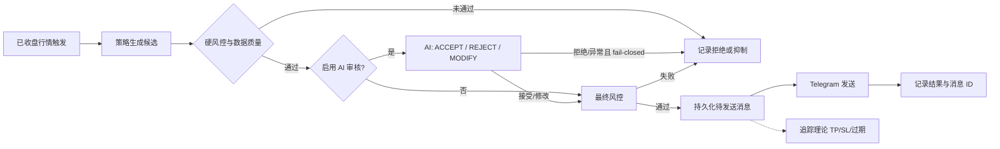

# 多交易所 AI 辅助交易信号监控机器人 — 产品需求规格（PRD）

> - 文档版本 v1.2
> - 编写于 2026-11-22，更新于 2026-11-24
> - M0–M4 功能已交付。Telegram 私聊实发待联调，下一阶段为 M5。
> - 产品暂定名 **Market Sentinel**
> - 默认时区 `Asia/Kuala_Lumpur`（UTC+08:00）。存储、计算与 K 线对齐统一使用 UTC。
> - 默认运行模式为**只读行情分析与提醒**。

---

## 1. 项目概述

开发一个可自行部署的行情监控平台。用户通过 Web 控制面板配置监控市场、时间周期、技术指标、风险约束、Telegram 通知和可选 OpenAI 审核；服务持续接收 Bitget 与 Hyperliquid 的行情，在满足策略条件时生成交易候选信号，通过规则风控或 AI 二次审查后发送交易建议，并在本地数据库保留完整信号、行情证据及事后表现，供复盘与回测。

### 1.1 产品目标

1. **多市场**：支持 Bitget、Hyperliquid 的永续合约与现货市场；包含两平台实际上市的加密资产、RWA 相关股票/黄金/原油等交易标的。
2. **可配置**：可在 Web 面板独立设置每个市场的观察时间周期、策略参数、策略启用状态、提醒规则和风险约束。
3. **双模式提醒**：不配置 OpenAI API Key 时使用确定性规则直接提醒；配置并启用 AI 后由 AI 接受、拒绝或建议修改候选信号，再经程序化风控发送。
4. **可解释**：每条信号提供市场与方向、触发时间、当前价格、建议入场参考、止盈止损、策略原因、风险收益比及适用性限制。
5. **持仓感知**：可选地使用只读交易所权限或公开链上账户状态读取持仓，生成减仓、持有、保护止损等建议。
6. **可验证**：完整存储候选信号、拒绝原因、AI 输入输出、数据质量、Telegram 发送状态、后续价格轨迹和回测结果。
7. **可扩展**：市场数据、指标、策略、风险规则、AI 提供方、通知渠道、回测与未来执行模块解耦。

### 1.2 明确不做（MVP）

- 不自动开仓、平仓、挂止盈止损单；任何“移动止损”仅是**通知建议**，不是交易所已提交委托。
- 不向 AI 提供交易所下单工具权限，也不将 API 交易密钥发给 AI。
- 不承诺盈利、不保证“置信度”等于真实胜率。
- 不宣称覆盖所有黄金、原油或股票产品：**只能监控交易所确实提供且接口可获取数据的标的**。
- 不将 HIP-3 股票/黄金/原油永续合约视为对应实物、股票或代币的直接所有权；必须在界面上标记产品性质。
- 不在缺失真实数据时编造 OI、成交量、资金费率或其他指标。

## 2. 用户与使用场景

主要用户：自行使用的交易员/开发者，先单用户部署，未来可扩展多用户隔离。

| 场景 | 用户操作 | 预期系统行为 |
|---|---|---|
| 初次使用 | 设置 Telegram Bot Token、配对 Chat ID | 发送测试消息，确认目标聊天可接收提醒 |
| 监控行情 | 搜索交易对、选择 Bitget / Hyperliquid 和周期 | 展示真实可用市场与数据源能力，开启或暂停监控 |
| 自定义策略 | 调整 RSI、EMA、成交量、OI 阈值 | 即时校验范围并保存带版本号的策略配置 |
| 无 AI 模式 | 启用规则通知 | 候选信号通过硬性校验后立即加入通知队列 |
| AI 模式 | 启用 OpenAI、选择模型及预算 | AI 返回 `ACCEPT/REJECT/MODIFY`，硬风控复核后通知 |
| 持仓分析 | 添加 Bitget 只读凭证或 Hyperliquid 钱包地址 | 展示仓位风险并推送“仓位管理建议”类型通知 |
| 事后复盘 | 打开历史信号 | 查看当时所用策略、行情、AI 理由、后续 TP/SL 是否触及 |
| 回测 | 选择市场、策略版本、日期、成本假设 | 输出交易次数、胜率、回撤、盈亏与数据限制 |

## 3. 数据来源与市场范围

### 3.1 交易所及产品支持矩阵

| 产品类别 | Bitget | Hyperliquid | OI 可用性 | 说明 |
|---|---|---|---|---|
| 加密货币永续合约 | 支持（Classic/UTA 按账户类型） | 支持原生永续 | 通常可用 | OI 来源、单位和更新时间需逐交易所确认 |
| 加密货币现货 | 支持 | 支持 | **不适用** | 不把“没有 OI”当作 OI=0 |
| 股票/ETF 等代币化现货 | 仅在确实上市且接口支持时 | 仅在确实上市且接口支持时 | **不适用** | Bitget Reality rToken 属于独立产品，需识别 `isReality` |
| 股票/黄金/原油/指数相关永续 | 仅已上市合约 | HIP-3 builder-deployed 永续，按实际上市列表发现 | 通常取决于产品/接口 | HIP-3 使用 DEX 命名空间，诸如 `xyz:GOLD`；不硬编码符号清单 |
| 未在这两家交易所上市的链上 RWA Token | MVP 不支持 | MVP 不支持 | 视源而定 | 未来需独立 on-chain / 第三方 Provider Adapter |

**重要边界**：Bitget 的部分 Reality 股票产品对 WebSocket K 线周期、成交量字段有例外，不能假定其 `3m` 与所有 1m volume 都可用。若必须合成 3m，先验证较低周期真实 OHLCV 完整性；不完整则禁用该周期并显示原因。

### 3.2 市场发现与标识

- 面板不能只让用户填自由文本后直接订阅：先同步交易所 `instruments/meta`，再提供带搜索的选择器。
- 市场内部唯一键由 `exchange + market_type + product_type + venue/dex + native_symbol` 组成；同名资产跨交易所、现货/永续、HIP-3 DEX 均视为不同市场。
- 展示内容：交易所、产品类别、原生交易对、计价资产、可用周期、价格精度、交易状态、OI 支持情况、成交量单位、资金费率可用性、是否为 RWA/合成永续。
- 新上市、暂停交易、退市或产品变更须重新同步；不可用时自动停止发新信号，但保留历史。
- 不自动合并 Bitget 的 `BTCUSDT` 与 Hyperliquid 的 `BTC` 为同一执行市场；允许在分析层建立同一底层资产关联供交叉验证。

## 4. Web 控制面板

### 4.1 导航与功能

| 页面 | 主要模块 | MVP 级别 | 当前交付 |
|---|---|---|---|
| 总览 Dashboard | 服务连接状态、监控市场数、今日候选/发送/拒绝信号、最近提醒、异常告警 | P0 | M4 已补充信号汇总、最近提醒、告警和备份清理状态。 |
| 市场监控 | 交易所/类型/市场筛选、新增、暂停、删除、批量启停及各周期配置 | P0 | M1 已交付双交易所市场监控。 |
| 策略配置 | 内建策略、启停、参数编辑、市场覆盖规则、参数校验及配置版本 | P0 | M2 已在监控卡片提供策略配置和版本。 |
| 通知与 AI | Telegram 配对与测试、AI Key、模型、审核开关、超时、预算及故障策略 | P0 | M3 已交付单私聊配对与测试、凭证掩码及可选 AI 审核。审核故障采用 `FAIL_CLOSED`。 |
| 风控设置 | 止盈止损、最低 R:R、滑点/点差、信号冷却及每日上限 | P0 | 「策略与风控」提供逐市场阈值、止盈止损和冷却设置。「通知与 AI」提供每日通知上限。 |
| 信号历史 | 候选、接受、拒绝、发送、命中 TP/SL、详情、筛选和 CSV 导出 | P0 | M4 已交付独立历史、筛选、按策略和交易所汇总、CSV/JSON 导出及理论表现。 |
| 持仓 | Bitget 只读连接、Hyperliquid 公共地址、当前持仓与风险建议 | P1 | M5 计划。 |
| 回测 | 历史区间、策略版本、成本参数、结果及可复算报告 | P1 | M6 计划。 |
| 运行诊断 | REST/WS 延迟、K 线缺口、OI 最新时间、重连、错误、AI 花费 | P1 | 市场监控已展示行情诊断、通知队列、最近入队延迟和当日 AI 用量。 |

### 4.2 主要配置项

**市场级配置**：启用状态；策略模板和覆盖参数；触发周期（默认 `3m`）；确认周期（默认 `5m`）；方向过滤周期（默认 `1h`）；数据类型；是否接受降级数据；通知等级；冷却时间；是否启用持仓联动。

**全局配置**：时区显示；Telegram 目标；AI 开关和模型；允许每日通知次数；全局 / 单市场冷却；最长行情延迟；最低流动性要求；默认止损、TP 档位；日志及市场数据保留天数。

**配置约束**：禁止保存负价格、非法时间周期、EMA 周期顺序异常、RSI 阈值越界、TP 分批比例不等于 100%、无止损却提供“可执行信号”等状态。

## 5. K 线、指标与行情处理

### 5.1 K 线基本要求

- 默认同时观察 `3m`、`5m`、`1h`；用户可在支持的周期中更换三种角色，且允许额外观察周期。
- 每条 K 线必须记录：`open_time_utc`, `close_time_utc`, `open`, `high`, `low`, `close`, `base_volume`, `quote_turnover`, `is_closed`, `source`, `quality_flags`。
- **只使用已经收盘且校验完整的 K 线产生正式信号**。运行中的最新 K 线仅供面板预览或“观察中”状态。
- WebSocket 提供及时更新；REST 用于首次回填、掉线恢复和定期核对。
- 服务重启后自动回填断档，按 `market + timeframe + open_time` 去重更新；不混用不同交易所的同一交易对计算指标。
- 统一 UTC 周期边界；整点、日线不得按浏览器本地时间重新切分。
- 默认每个周期准备不少于 300 根已收盘 K 线，建议 500 根用于 EMA144 预热及稳定性评估；历史不足时不允许发正式信号。
- 价格、成交量使用高精度十进制存储/运算；技术指标中可以使用 `number`，但必须校验有限值与精度。

### 5.2 初始技术指标

| 指标 | 默认参数 | 作用 | 注意事项 |
|---|---|---|---|
| EMA | 21 / 55 / 144 | 大/中/短趋势识别 | 按每个周期单独计算，不跨周期拼接 |
| RSI | 14，Wilder RMA | 动量及过热/过冷观察 | 不直接把 RSI>70 判定为做空 |
| Relative Volume | 当前已收盘量 / 前 20 根平均量 | 识别放量 | 仅比较相同周期、相同量纲的 K 线 |
| Open Interest Δ | 当前与相隔指定分钟的历史快照比较 | 识别持仓量变化 | 仅永续；快照必须足够新且单位一致 |
| ATR | 14 | 计算止损距离及波动过滤 | 为新增的风控辅助指标，不替代用户指定四类指标 |
| Spread / Liquidity | 点差、最小名义成交额 | 避免滑点和低流动性 | 无有效盘口或报价则拒绝发信号 |

### 5.3 OI 数据约束

- OI 独立于 OHLCV，作为定时或推送的**快照序列**存储，绝不将一根 K 线成交量代替 OI。
- 默认采样间隔 `60s`，以固定回看窗口（默认 `15m`）计算变化百分比：`(OI_now / OI_past - 1) × 100%`。
- 记录原始 OI 数值、单位（币、张、名义 USD 等）、转换公式与数据来源。同一比较窗口必须使用可比单位。
- 永续默认 `oiRequired=true`；缺失、陈旧或连续性不足时跳过需要 OI 的策略。可单独启用“不使用 OI 的降级策略”，并明确标记。
- 现货策略 `oiRequired=false` 且 UI 显示 `N/A`，不能使用永续专属阈值。
- 回测只能使用历史当时真实存在的 OI 快照；若交易所未提供历史 OI 且本地尚未采集，则不允许伪造 OI 历史回测。

## 6. 初始策略体系

### 6.1 策略原则

- 初始为 **顺势回踩 / 放量确认（Trend Pullback & Volume Confirmation）**。先判断 1h 方向，再由 5m 提供动量确认、3m 提供收盘触发。
- 多策略采用“信号候选 → 打分/证据 → 风控 →（可选 AI）→ 最终核验 → 通知”；避免多个策略直接各自发送消息。
- `BUY/LONG`、`SELL/SHORT`、`NO_TRADE` 是信号方向；现货无可用融券/杠杆能力时，`SHORT` 不应表示可直接在现货卖空，改标记为 `BEARISH_WATCH` 或对已有现货提供 `REDUCE/EXIT` 建议。
- 策略表现应通过数据验证；以下阈值仅是**初始可调整的启发式默认值**，不是已证实盈利参数。

### 6.2 默认做多条件（全部满足）

1. `1h` 已收盘 K 线：`EMA21 > EMA55 > EMA144` 且收盘价高于 `EMA21`。
2. `5m` 已收盘 K 线：`RSI(14)` 在 `50–70`，并保持或重新转为正向动量（默认 RSI 比上一根上升）。
3. `3m` 已收盘 K 线：收盘价高于 `EMA21`；`relativeVolume(20) >= 1.5`；短期价格确认规则启用（默认收盘价高于前一根最高价，可关闭）。
4. 永续合约：最近 `15m` OI 增幅 `>= +0.5%`，快照非陈旧；现货跳过本项并采用单独的现货策略配置。
5. 不触发低流动性、极端波动、数据缺口、信号冲突、价格偏离、已过期等硬风控。

### 6.3 默认做空条件（镜像）

1. `1h`：`EMA21 < EMA55 < EMA144`，收盘低于 EMA21。
2. `5m`：RSI 在 `30–50`，且较前一根下降。
3. `3m`：收盘价低于 EMA21、相对成交量 `>=1.5`，且低于前一根最低价（可关闭）。
4. 永续 OI 增幅默认 `>= +0.5%`（说明“新仓参与”，**并不等同确定是空头建仓**）；现货沿用不含 OI 的独立配置。
5. 必须通过方向能力与风控检查。

> OI 上升伴随上涨/下跌只能作结构性辅助证据，不能仅凭 OI 确认买方或卖方主动性；后续可增加逐笔成交、主动买卖量与订单簿策略。

### 6.4 策略扩展类型

- 初始启用：`TrendPullbackV1`（EMA+RSI+成交量+可选 OI）。
- 预留：趋势突破、均值回归、RSI 背离、资金费率异常、OI 激增/挤仓、跨交易所价差、清算密集区、盘口失衡、波动率突破及事件过滤。
- 每条策略独立维护 `strategy_id`、`strategy_version`、参数 schema、数据依赖、特征提取和证据说明。
- 可设置 `AND/OR/评分` 策略组合；**MVP 先提供独立策略与有限的市场级覆盖参数**，可视化任意策略编排留待后续。

## 7. 入场、止盈、止损与风控

### 7.1 价格规则

- 正式提醒包含 `signal_price`（信号触发时可用的实时参考价）和 `candle_close`（触发 K 线收盘价），两者不可混为一谈。
- `entry_reference` 默认取发送前最新可用的交易所参考报价；若与触发收盘价的偏差大于阈值，则取消或标注“已过期”，不追价。
- 初始止损取结构低点/高点与 ATR 缓冲的**更保守一侧**，例如多头 `min(最近10根已收盘K线最低价, entry-1.2×ATR14)`，空头对称。随后校验距离、价格档位及市场合理性。
- 设风险距离 `R=|entry-stop|`，必须 `R>0` 且止损位于交易方向正确一侧。
- 默认两档止盈：`TP1 = 1.5R`（减仓 50%）、`TP2 = 3.0R`（剩余 50%）；支持单档全部止盈、自定义最多 4 档及比例，累计必须 100%。
- **示例**：多头参考入场 100、止损 98，则 `R=2`，TP1=103、TP2=106（仅说明计算，不是市场报价）。
- 如启用移动止盈/止损：需明确触发条件、回撤幅度或 `ATR` 倍数、只朝锁定利润的方向移动、对应剩余仓位比例；通知建议与真实交易所订单状态严格分开。
- 默认按各市场最小价格单位四舍五入至合法档位，再次检查方向与 R:R。

### 7.2 硬风控（AI 不能绕过）

| 检查 | 建议初始参数 | 不通过处理 |
|---|---|---|
| 数据延迟 | 触发收盘数据不得超过 60 秒，或按周期配置 | `REJECT_STALE_DATA` |
| 交易所 / 市场状态 | 必须在线、可交易，交易所行情无异常 | `REJECT_MARKET_UNAVAILABLE` |
| K 线完整性 | 关键周期无缺口且全部为已收盘 | `REJECT_INCOMPLETE_CANDLE` |
| OI 有效性 | 需要 OI 时最新样本距当前不超过 180s，回看样本有效 | `REJECT_OI_UNAVAILABLE` |
| 最小加权收益风险比 | `>= 2.0`（按 TP 分仓比例加权） | `REJECT_LOW_RR` |
| 价格偏离 | 入场参考价与触发收盘价偏差不大于 `0.3 × ATR(3m)` | `REJECT_PRICE_DRIFT` |
| 止损距离 | 按资产类别配置范围，避免过紧/过宽 | `REJECT_INVALID_STOP` |
| 流动性 / 点差 | 盘口有效，点差与成交额满足市场级阈值 | `REJECT_LIQUIDITY` |
| 单市场冷却 | 默认 30 分钟，按市场、方向与策略系列计算，以已送达、送达不确定或仍待发送的有效正式信号为依据 | `SUPPRESS_COOLDOWN` |
| 重复与冲突 | 同一策略版本、同一触发 K 线、方向仅一条；冲突方向不能同时推荐 | `SUPPRESS_DUPLICATE/CONFLICT` |
| 每日通知节流 | 按应用时区计日，默认每市场 8 条、全局 30 条 | `SUPPRESS_DAILY_LIMIT` |

- 行情异常、网络断连、价格非正数、NaN、指标不足、过期信号时**默认不发新的交易建议**；服务故障可发单独的系统告警。
- 价格及止盈止损建议需结合交易所 tick size、价格保护及市场类型；缺失精度元数据不得发可执行格式。
- “信号最大允许杠杆”不是自动下单指令，MVP 不主动推荐高杠杆。未来仓位建议应先根据账户风险和止损距离限定名义金额。
- 对黄金/原油/股票类 24/7 交易市场额外警示：传统标的休市期间可能存在报价、流动性、基差、预言机与跳空风险。

## 8. 信号状态机与发送规则



- `candidate`：被策略识别，未获准发送。
- `rejected`：数据质量/风控/AI 拒绝；仍保留审计记录。
- `approved`：通过全部检查但尚未发送。
- `sent` / `send_failed` / `delivery_unknown`：发送结果。Telegram 发送成功不代表用户读到。
- `ACTIVE`、`TP1_HIT` 至 `TP4_HIT`、`SL_HIT`、`EXPIRED`、`INVALIDATED` 是理论表现状态，独立于送达状态与交易所实际持仓和成交。追踪从批准后的首根完整触发周期 K 线开始，最多处理 20 根。

M3 从新产生的实时交易候选开始处理，保留既有候选供查询。正式信号与待发消息一同落库，出队前复查信号有效期、监控状态、配对和通知上限。超时或重启时尚在发送中的记录标记为 `DELIVERY_UNKNOWN`。同一配对下仍有效的信号允许管理员确认补发一次，并在消息中标明可能重复。

### 8.1 Telegram 规则模式示例

```text
📈 [规则信号] 做多 LONG
时间：2026-11-22 22:30:00 (UTC+8)
市场：Bitget | BTCUSDT | 永续 USDT
策略：TrendPullbackV1 · 1h趋势 / 5m确认 / 3m触发
触发K线收盘：示例 100.00 USDT
当前参考价：示例 100.10 USDT
参考入场：100.10 USDT（非成交价）
止损 SL：98.10 USDT（全部退出）
止盈 TP1：103.10 USDT（50%）
止盈 TP2：106.10 USDT（50%）
加权 R:R：2.25
原因：1h EMA21>55>144；5m RSI 上升；3m 放量且突破；15m OI 增加。
注意：这是提醒，不代表已下单；需要考虑手续费和滑点。
信号 ID：SIG-EXAMPLE-001
```

### 8.2 Telegram AI 审核模式示例

```text
🤖 [AI审核通过] 做空 SHORT
时间：2026-11-22 22:35:00 (UTC+8)
市场：Hyperliquid | xyz:GOLD | HIP-3 黄金相关永续
策略：TrendPullbackV1 + AIReview
当前参考价：示例 100.00 USDC
参考入场：100.00 USDC
止损 SL：102.00（100%，若3m连续两根收盘创新低，则按策略移动到保本价；仅通知建议）
止盈 TP1：97.00（减仓50%）
止盈 TP2：94.00（减仓剩余50%）
AI决策：ACCEPT
置信度：72/100（AI主观评分，未经历史校准）
原因：较大周期下行、短周期放量、OI持续上升；注意衍生品与传统金价基差风险。
风险：RWA相关永续在传统市场休市时流动性可能降低。
信号 ID：SIG-EXAMPLE-002
```

以上价格与日期均为**格式示例**，不对应真实行情或交易建议。若 AI 拒绝，则默认不发送交易建议，但在面板保留 `REJECT` 及原因；可选单独发送“审核拒绝摘要”，默认关闭以减少干扰。

### 8.3 Telegram 通知类型

- `TRADE_SIGNAL` 已通过 M3 的规则与 AI 通知链路。
- `SIGNAL_UPDATE` 用于止盈、止损调整、到期和失效等追踪通知。默认开启，发送到已收到原提醒的同一私聊。
- `POSITION_ADVICE` 随 M5 提供基于真实账户持仓的风险建议。
- `SYSTEM_ALERT` 用于行情中断、接口故障、凭证异常、数据库故障恢复、AI 预算耗尽和备份清理失败。默认开启，可在通知设置关闭。Telegram 自身的凭证异常显示在总览。
- 禁止在 Telegram 内容中包含 API Key、Secret、Passphrase、完整 AI prompt 中的敏感内容。

## 9. OpenAI 审核模块

### 9.1 开关、配置与决策

- AI 默认关闭，采用 `RULE_ONLY`，通过最终风控且已配对的市场信号进入发送队列。
- 启用 AI 后采用 `AI_REVIEW` 和 `FAIL_CLOSED`。凭证缺失、置信度不足、审核拒绝或审核异常均结束该候选的通知流程并记录原因。
- AI 输入只包含经清洗后的市场结构化信息：交易所与合约类型、最近有效 OHLCV 汇总、EMA/RSI/成交量/OI/ATR、趋势证据、候选方向、止盈止损、流动性风险、现有仓位摘要（如启用）。
- M3 使用 Structured Outputs 返回 `decision`、`confidenceScore`、`rationale`、`riskFlags`、`rejectReason` 和 `levelAdjustment`。模型、用量和估算费用另存于审核记录。
- `REJECT` 必须保存原因；`MODIFY` 只允许修改程序许可的止盈止损/管理建议，**不得直接更改方向、市场或偷偷放宽硬风控**；如需反方向，生成独立候选信号重新评估。
- 置信度 `0–100` 是 AI 自评的主观确定程度，不是统计校准的盈利概率；后续可基于历史同类信号做可靠性曲线校准。
- API 超时、解析失败、模型拒绝、余额或配额异常时记录状态，不将未审核候选伪装成已审核。

### 9.2 成本与隐私

- 面板可选模型，显示每次 token 用量与估算费用、每日调用次数和预算，默认每日预算为 USD 1。审核前预留估算额度，取得用量后结算。面板发起的结构化响应测试计入当日预算。
- M3 对同一候选最多发起一次正式审核，重连或重启时复用已保存结果。后续如开放人工重评，需创建独立审核版本。
- AI API Key 加密保存或仅通过环境变量注入；UI 保存后只能查看掩码，不返回明文。
- 不传送交易密钥、私钥、完整账户身份资料给模型；持仓只发送最小必要数值，并可在面板关闭这项发送。
- AI 文本的市场消息、名称等视为不可信数据，模型输出经过结构及业务规则校验。

## 10. 可选持仓分析

### 10.1 连接方式

- **Bitget**：使用具有读取账户/持仓权限的 API Key（必要的 Secret/Passphrase 仅用于请求签名），拒绝交易/提币权限配置；建议绑定服务器固定 IP。UTA 优先当前 v3 持仓接口，兼容 Classic v2。
- **Hyperliquid**：只读取持仓通常可通过**公开钱包地址**查询 `/info`，不需要提供私钥、助记词或交易签名 Key；应能选择普通永续与 HIP-3 DEX 的仓位视图，并兼容账户抽象模式差异。
- 支持手动移除连接及删除密文；凭证失效需通知用户但不妨碍公共行情监控。

### 10.2 分析内容

- 方向、多空、数量、平均开仓价、当前 Mark/Last 参考价、未实现盈亏、估算 ROE、杠杆、保证金模式、清算价（可用时）、资金费率、距离止损/清算价、集中风险。
- 可选目标：`HOLD` / `PARTIAL_TAKE_PROFIT` / `REDUCE_RISK` / `MOVE_STOP` / `EXIT_WARNING`；必须标明是**风险建议**，不是已完成操作。
- 需识别一个市场对应多笔/双向仓位、跨账户、统一保证金等情况；无法准确计算的字段显示 `未知`，不能假装为零。
- 若账户同时有现货持有与永续空单，分别分析并预留组合净敞口视图。
- 默认每 5 分钟同步持仓，并对大幅风险变化/接近清算等事件优先发送提醒；具体节流可调。

## 11. 信号记录、理论表现与回测

### 11.1 必须保留的证据

每条候选信号保存：唯一 ID、市场键、触发 K 线 UTC 时间、各时间周期 ID、策略及参数版本、指标快照、原始 OI 时间和单位、候选与最终方向、建议入场/TP/SL、规则风控结果、AI 调用版本与结构化结果、消息内容与 Telegram 状态、发送时间、报价与数据新鲜度、后续价格轨迹结果、拒绝/失效原因。

### 11.2 事后追踪与回测定义

- **通知不是成交**：信号表现为“理论策略表现”，不得直接和交易所实际已实现 PnL 混合。
- 回测按历史 K 线顺序重放；每一步只能使用当前及过去已结束 K 线，以及当时已经采集到的 OI 快照。
- 考虑手续费、资金费率、滑点、点差、报价偏离、最小交易单位及不同产品市场时段。
- 支持：全量止盈、分批止盈、剩余仓位移动止损、超时退出、方向冲突退出。
- 同根 K 线同时触碰 TP 与 SL 时，默认采用**保守的 SL 优先**推断，并标注为 `ambiguous_intrabar`；精确回放可在有可靠更低周期数据时使用实际路径。
- 因通知和交易执行可能有延迟，回测禁止假定刚收盘就能无滑点地按收盘价成交；默认下一根可成交区间加成本进行模拟。
- AI 回测须使用**历史时点已保存的 AI 审核结果**，或明确运行新的离线 AI 评估并单独计价、单独标注；不能把今天的 AI 判断写回历史伪装实时记录。

### 11.3 分析报表

- 信号数、AI 通过/拒绝率、送达成功率、方向分布、按市场/策略/周期分组。
- 理论命中 TP1/TP2/SL、平均 R 倍数、Profit Factor、最大回撤、胜率、期望值、平均持有时间、成本后收益、最大连续亏损。
- 对比规则模式 vs AI 模式（需控制样本选择偏差）、不同参数版本、不同交易所及不同资产类型。
- 可导出 CSV/JSON，回测结果必须指向原始数据集、策略版本、回测配置和执行版本哈希，以便复算。

## 12. 非功能需求与安全

| 维度 | 验收目标 |
|---|---|
| 部署 | Windows 本地开发、Linux Docker 部署；单机 SQLite 开箱即用 |
| 可靠性 | WS 断线指数退避重连，恢复后 REST 回填；无数据时 fail-safe |
| 延迟 | 正常网络、正常负载下，收盘触发到**进入发送流程**目标不超过 60 秒；记录端到端实测耗时 |
| 去重 | 同一事件在 WS 重连、进程重启或重复投递时，不得生成多条正式候选信号 |
| 数据正确性 | UTC 时间戳、严格已收盘处理、无未来函数、decimal/tick-size 校验 |
| 鉴权 | 单用户面板需登录；部署到公网必须 TLS、强身份验证和速率限制 |
| 凭证 | 本地密钥加密保存、环境变量保护、日志脱敏；禁止任何私钥/提币权限 |
| 可观测性 | 提供健康检查、订阅数、数据延迟、AI 耗费、发送失败、数据库占用等指标 |
| 数据保留 | 信号和配置审计默认永久保存（用户可手动导出/删除）；市场 K 线、OI 按策略设置保存与清理 |
| 故障隔离 | 某单一市场/交易所断连不会阻断其他市场；AI 失效不影响纯规则模式 |

## 13. 优先级、发布范围与验收

### Phase A / P0：可用的最小产品

- 市场发现、Bitget/Hyperliquid 适配器、3m/5m/1h OHLCV、公共 OI、单机本地数据库。
- EMA21/55/144、RSI14、成交量均值比、OI 变化、ATR 风控。
- Web 设置页、启停监控、规则信号、Telegram 配对/测试及真实通知。
- OpenAI 可选审核、明确 fail-closed、所有候选和审核记录落库。
- 信号状态、基本历史查询、理论 TP/SL 追踪与导出，以及日志、健康检查和自动重连。

### Phase B / P1：复盘与账户上下文

- Bitget 只读持仓与 Hyperliquid 地址查询；仓位风险提醒。
- 历史数据回填及带交易成本的规则回测，在 P0 理论信号事件和导出的基础上扩展表现分析。
- 操作诊断、告警降噪、AI 成本统计和策略版本比较。

### Phase C / P2：扩展能力

- 多策略组合和策略插件、多账户、多通知渠道、可视化图表/回测对比。
- 独立 on-chain RWA 数据源、订单簿/资金费率/跨市场信号。
- 经独立风险/安全设计后再考虑 Paper Trading 和可选真实交易执行器。

### 13.1 核心验收用例

1. **同一市场并发三周期**：可接收、存储、展示 3m/5m/1h OHLCV，且不出现未闭合 K 线提前触发。
2. **Bitget 与 Hyperliquid 同时监控**：单一交易所断线，另一交易所不受影响；重连自动补齐断档。
3. **无 OI 的现货**：使用独立 spot 策略运行，界面显示 `N/A`；永续依赖 OI 而 OI 缺失时拒绝信号。
4. **有效信号**：消息包含 UTC+8、交易所/类型/符号、参考价、方向、TP/SL、比例、原因与策略。
5. **AI 拒绝**：Telegram 不发送交易建议；数据库含拒绝理由、模型与调用记录。
6. **AI 修改**：修改后若 R:R 低于阈值、方向/价格关系不合法或止损超限，则再次拒绝。
7. **去重**：重复 WS 更新和服务重启后，同一触发条件只产生一条正式信号及自动发送记录。送达不确定及管理员确认补发均留有审计。
8. **持仓权限**：Bitget 交易/提币授权凭证被拒绝；Hyperliquid 公开地址即可读取支持的账户状态。
9. **真实历史回放**：禁用未来数据；缺失历史 OI 时明确提示“不支持该策略的可靠历史回测”。
10. **消息与数据库一致**：任何已发送信号可反查数据快照、参数、审核结果及 Telegram message ID。

### 13.2 当前交付进度

| 里程碑 | 状态 | 进度依据 |
|---|---|---|
| M0 工程基座 | 已交付 | Windows 本地启动、SQLite 迁移、管理员会话和健康检查已验收。 |
| M1 市场注册与行情采集 | 已交付 | Bitget 与 Hyperliquid 主网各启用 10 个永续市场，共 60 条默认周期流达到预热门槛。 |
| M2 指标、策略与硬风控 | 已交付 | 固定样本验证了双源策略、现货观察、时间对齐、配置版本和预风控记录。 |
| M3 Telegram 与 AI 审核 | 功能已交付，私聊实发待联调 | 53 项自动化测试通过，Edge 通过模拟配对和发送流程，真实 `gpt-6-luna` 结构化审核通过。真实 Telegram Bot `getMe` 在联调环境超时。 |
| M4 信号追踪与复盘 | 已交付 | 已收盘 K 线理论追踪、历史筛选、统计、导出、诊断告警、数据清理和在线备份恢复已实现。 |

P0 发布仍待 Telegram 真实私聊送达验收。主要验证记录见 [M1 行情验收](./development-plan/2026-11-23-m1-market-data.md)、[M2 策略验收](./development-plan/2026-11-24-m2-strategy-risk.md)、[M3 通知与 AI 验收](./development-plan/2026-11-24-m3-telegram-ai.md) 及 [M4 信号复盘验收](./development-plan/2026-11-24-m4-signal-review.md)。

## 14. 默认配置与待验参数

| 参数 | 默认值 | 设计理由 |
|---|---|---|
| 主策略 | TrendPullbackV1 | 与 EMA/RSI/量/OI 一致 |
| 周期角色 | 趋势 1h、确认 5m、触发 3m | 按请求设置 |
| OI 回看 | 15m，快照 60s | 不将 OI 等同 K 线指标 |
| 放量阈值 | RVOL 1.5 | 降低普通波动误报 |
| TP | 1.5R 50% + 3R 50% | 分批止盈 |
| 最低加权 R:R | 2.0 | 避免无吸引力的盈亏结构 |
| 冷却 | 每市场、方向、策略系列 30m | 降噪 |
| AI 审核 | 关闭，模型默认为 `gpt-6-luna`，可选 `gpt-6.1-terra` | 按需启用结构化审核 |
| AI 异常 | FAIL_CLOSED | 避免误以为已审核 |
| 审核置信度阈值 | 70（启用 AI 时） | 主观分数，待后验校准 |
| AI 超时与输出上限 | 10 秒，1,024 个输出 tokens | 约束审核等待时间与单次费用 |
| AI 每日预算 | USD 1，按应用时区计日 | 费用按 token 用量估算 |
| 每日提醒上限 | 每市场 8、全局 30，按应用时区计日 | 限制提醒频次 |
| 仓位同步（M5 计划） | 5m | 按接口限额可调整 |
| 系统时间 | UTC 存储、UTC+8 展示 | 时区与 K 线一致性 |

## 15. 官方接口参考（核对于 2026-11-22）

1. Bitget V3 市场数据（instrument、K 线、历史 K 线）：https://www.bitget.com/docs/catalog/market/market-data
2. Bitget V2 合约行情 / OI：https://www.bitget.com/docs/catalog/classic-contract-market/classic-contract-market
3. Bitget V3 持仓：https://www.bitget.com/legacy-docs/uta/trade/Get-Position
4. Bitget rToken 产品与例外：https://www.bitget.com/docs/uta/reality-trading-guide
5. Hyperliquid Info API：https://hyperliquid.gitbook.io/hyperliquid-docs/for-developers/api/info-endpoint
6. Hyperliquid WebSocket 订阅：https://hyperliquid.gitbook.io/hyperliquid-docs/for-developers/api/websocket/subscriptions
7. Hyperliquid HIP-3：https://hyperliquid.gitbook.io/hyperliquid-docs/hyperliquid-improvement-proposals-hips/hip-3-builder-deployed-perpetuals
8. Hyperliquid API 限流：https://hyperliquid.gitbook.io/hyperliquid-docs/for-developers/api/rate-limits-and-user-limits
9. Telegram Bot API：https://core.telegram.org/bots/api
10. OpenAI Structured Outputs：https://developers.openai.com/api/docs/guides/structured-outputs

> **实施提醒**：API 文档和交易所市场随时变化。适配器上线前应对真实返回字段、RWA 特例、Rate Limit、权限和仓位口径执行接口契约测试。策略默认值是产品建议，不是经过回测确认的交易优势。
