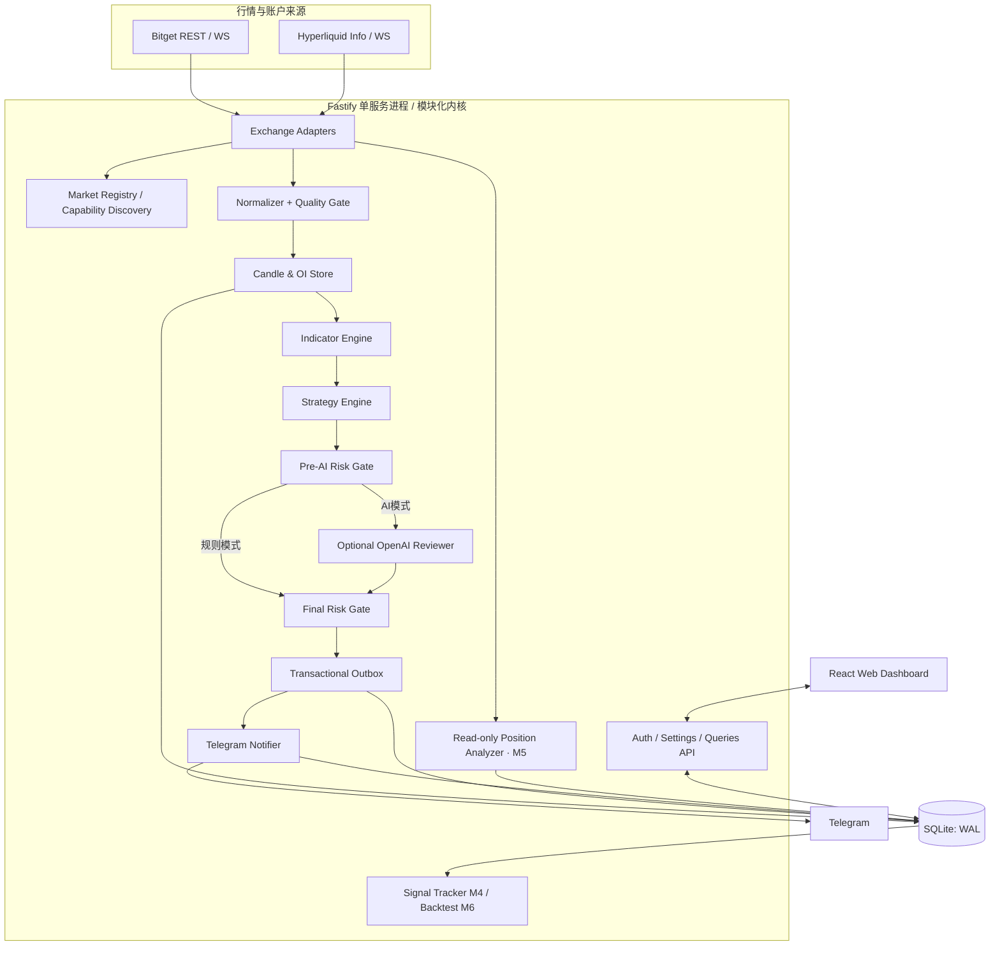

# Market Sentinel — 技术架构与开发实施计划

> - 文档版本 v1.1
> - 编写于 2026-11-22，更新于 2026-11-24
> - 实现基线 `d348a78`。M3 功能已交付，Telegram 私聊实发待联调。
> - 对应需求见 [产品需求规格](./01-产品需求规格-PRD.md)。
> - 开发原则为**行情与策略解耦、确定性风控优先、先只读提醒、事件可追溯、可重复回测**。

---

## 0. 总体技术决策

| 层 | 选型 | 取舍依据 |
|---|---|---|
| 开发语言 | TypeScript + Node.js 26 LTS | 同一语言覆盖后端、策略、前端与回测 |
| Monorepo | npm 11 workspaces + TypeScript project references | 模块共享，依赖由根目录的 `package-lock.json` 锁定 |
| Web 前端 | React + Vite + TypeScript + TanStack Query | 支持控制台配置与轮询，历史图表按后续复盘需求选型 |
| API / 服务器 | Fastify + Zod | HTTP、配置校验、健康检查及未来 API 扩展 |
| 行情长连接 | `ws`，REST `fetch`/Undici | 直接接入 Bitget/Hyperliquid，不引入隐含业务逻辑的聚合供应商 |
| 数据库 | `node:sqlite` + WAL + Drizzle ORM 与迁移 | 支持单用户本地部署，为后续迁移保留领域契约 |
| 定时任务 | 内置调度器 + SQLite 持久化任务 / Outbox | 单机无 Redis 依赖，进程重启可恢复 |
| 指标 | 版本化的 EMA、RSI-Wilder、ATR、RVOL 和 OI 变化率 | 指标口径可控，供后续回测复用 |
| AI | OpenAI 官方 Node SDK `7.63.0`，Responses API + Structured Outputs + Zod | 可选审核与严格契约校验 |
| 消息通知 | Telegram Bot HTTP API | 发送带 ID 的审计消息 |
| 测试 | Vitest、固定 REST/WS 样本、SQLite 测试库及 Edge 联调 | 覆盖指标、契约、迁移和控制台端到端流程 |
| 部署 | Windows 本地启动已交付，Docker Compose 见部署规划 | API、采集、策略和通知运行在同一服务进程 |

**MVP 进程模型**：优先一个 Node.js 服务进程同时承载 API、市场接收、信号引擎和 Outbox worker；内部通过清晰接口隔离模块，避免过早引入多进程与 Redis。单一写入协调器减少 SQLite 写锁争用。未来当数据规模提升，再分离 `market-worker`、`signal-worker` 和 `notification-worker`，用 PostgreSQL + Redis/BullMQ 或事件总线替换调度实现，但**不修改领域契约**。

## 1. 系统架构



### 1.1 事件处理顺序

1. 服务启动时应用 SQLite 迁移、加载监控并同步交易市场及产品能力。Telegram 和 AI 的连接测试由管理员从设置页发起。
2. 建立市场与周期订阅，通过 REST 回填已收盘历史并采样 OI。WS 推送用于盘中预览，收盘确认结果幂等入库。
3. 实时收盘事件触发指标计算。触发周期只使用其收盘时点之前或同刻已经收盘的确认与趋势周期 K 线。
4. 策略在同一事务保存候选、不可变证据和 `PRE` 评估。新通过预风控的实时 `LONG` 或 `SHORT` 候选登记为待处理。
5. 处理时复查市场状态、行情时效、OI 和盘口。启用 AI 时，合格候选经结构化审核，再用不可变策略参数和最新盘口计算 `FINAL`。
6. 最终风控通过后原子写入 `signals` 和 `outbox_messages`。出队时复查监控、信号有效期、配对与通知上限，保存消息 ID 或失败原因。
7. M4 从正式信号和后续已收盘 K 线生成理论表现事件，M6 复用策略算法做离线回测。

## 2. 推荐代码目录

当前服务器模块位于 `apps/server/src/market-data`、`strategy` 和 `notification`，SQLite schema 与迁移随服务器维护。Web 控制台位于 `apps/web/src`，共享领域类型和契约位于 `packages/domain` 与 `packages/contracts`。以下目录树用于后续模块扩展与拆分参考。

```text
market-sentinel/
├── apps/
│   ├── web/                       # React + Vite 控制面板
│   │   └── src/
│   │       ├── pages/             # dashboard, markets, strategies, signals,
│   │       │                      # positions, backtests, settings, diagnostics
│   │       ├── components/        # charts, forms, signal cards
│   │       ├── api/               # typed HTTP client / query hooks
│   │       └── features/          # 按业务领域分目录
│   └── server/                    # Fastify + 单机 worker 启动入口
│       └── src/
│           ├── app.ts
│           ├── bootstrap.ts
│           ├── routes/            # auth, markets, monitors, strategies, signals,
│           │                      # telegram, ai, positions, backtests, health
│           ├── services/          # composition root, scheduler, lifecycle
│           └── workers/           # market, indicator, outbox, tracking
├── packages/
│   ├── domain/                    # Entity, enums, business invariants
│   ├── contracts/                 # Zod DTO & shared API types
│   ├── exchange-core/             # MarketDataProvider, AccountReader, Capability
│   ├── exchange-bitget/           # REST/WS, V3/Classic fallback, rToken cases
│   ├── exchange-hyperliquid/      # /info, WS, spot, native perp, HIP-3
│   ├── market-data/               # candles, OI, normalizer, backfill, quality
│   ├── indicators/                # EMA, RSI, ATR, RVOL and test fixtures
│   ├── strategies/                # Strategy registry, TrendPullbackV1
│   ├── risk-engine/               # hard gates / TP-SL builder / RR
│   ├── ai-review/                 # OpenAI request, JSON schema, fail-closed
│   ├── notification-telegram/     # formatter, sender, retry coordinator
│   ├── positions/                 # normalized positions / portfolio review
│   ├── signal-tracker/            # theoretical life cycle
│   ├── backtest/                  # event replay, fill model, metrics
│   ├── persistence/               # Drizzle schema, repositories, migrations
│   ├── security/                  # auth, encryption, redaction
│   └── observability/             # structured logs / metrics
├── configs/
│   ├── strategy-defaults.json     # 非敏感默认值
│   └── capability-overrides.json  # 特例覆盖，有注释和版本号
├── tests/
│   ├── contracts/                 # 交易所响应 schema 的 fixture
│   ├── e2e/
│   ├── fixtures/                  # 历史 K 线 / OI / 仓位样本（脱敏）
│   └── integration/
├── docs/
│   ├── architecture.md
│   ├── api-contracts.md
│   ├── runbook.md
│   ├── security.md
│   └── decisions/                # ADR: 数据源/价格/指标/执行约定
├── .env.example
├── .gitignore
├── docker-compose.yml
├── package.json
├── package-lock.json
└── README.md
```

**依赖规则**：`domain` 与 `contracts` 不得依赖具体交易所/数据库/AI；策略与回测只能依赖 `market-data` 和 `indicators` 的纯逻辑；Adapter 不得直接发送 Telegram；任何外部 I/O 通过接口注入；不要把 Web 路由逻辑写进策略。

## 3. 统一领域模型与接口

### 3.1 Market / Candle / OI

```ts
export type ExchangeId = 'BITGET' | 'HYPERLIQUID';
export type MarketType = 'SPOT' | 'PERP';
export type Timeframe = '1m' | '3m' | '5m' | '15m' | '30m' | '1h' | '4h' | '1d';

// marketId 使用数据库 UUID；以下组合必须设置唯一索引。
export interface MarketIdentity {
  exchange: ExchangeId;
  marketType: MarketType;
  productType: string;     // USDT-FUTURES / SPOT / HYPERLIQUID_PERP 等
  venue: string;           // Bitget 默认 main；Hyperliquid 主永续 main、HIP-3 如 xyz
  nativeSymbol: string;    // BTCUSDT / BTC / xyz:GOLD / @107
  baseAsset: string;
  quoteAsset: string;
}

export interface MarketCapabilities {
  intervals: Timeframe[];
  hasOpenInterest: boolean;
  hasOrderBook: boolean;
  hasFundingRate: boolean;
  supportsReadOnlyPositions: boolean;
  hasReliableBaseVolume: boolean;
  sessionType: 'CONTINUOUS' | 'RWA_WITH_REFERENCE_SESSION' | 'UNKNOWN';
  restrictions: string[];
}

// 价格和成交量在 I/O/存储层统一用 decimal string。
export interface Candle {
  marketId: string;
  timeframe: Timeframe;
  openTimeMs: number;     // UTC, inclusive
  closeTimeMs: number;    // UTC, exclusive
  open: string;
  high: string;
  low: string;
  close: string;
  baseVolume: string | null;
  quoteTurnover: string | null;
  isClosed: boolean;
  source: 'WS' | 'REST' | 'AGGREGATED';
  qualityFlags: string[];
}

export interface OiSnapshot {
  marketId: string;
  timestampMs: number;
  value: string;
  unit: 'BASE_ASSET' | 'CONTRACTS' | 'USD_NOTIONAL' | 'OTHER';
  unitDetails: string;
  source: 'REST' | 'WS';
  qualityFlags: string[];
}
```

**严格不变量**：`low <= min(open,close) <= max(open,close) <= high`、价格均为正、volume 非负、时间窗口严格匹配周期、禁止 NaN/Infinity、相同市场与 UTC 周期首时间仅一根 canonical 已收盘 K 线。任何合成 K 线须记录其构成基础 K 线数量及数据来源。

### 3.2 交易所适配器接口

```ts
export interface MarketDataProvider {
  readonly exchange: ExchangeId;
  discoverMarkets(): Promise<Array<{ identity: MarketIdentity; capabilities: MarketCapabilities }>>;
  fetchClosedCandles(marketId: string, timeframe: Timeframe,
    startMs: number, endMs: number): Promise<Candle[]>;
  subscribeCandles(marketId: string, timeframe: Timeframe,
    onUpdate: (candle: Candle) => Promise<void>): Promise<Unsubscribe>;
  fetchTicker(marketId: string): Promise<{
    last: string | null; mark: string | null; bid: string | null;
    ask: string | null; timestampMs: number;
  }>;
  fetchOpenInterest?(marketId: string): Promise<OiSnapshot | null>;
  fetchOrderBook?(marketId: string): Promise<{ bid: string; ask: string; timestampMs: number }>;
  health(): Promise<{ ok: boolean; latencyMs: number; detail?: string }>;
}

export interface AccountReader {
  listPositions(accountRef: string): Promise<NormalizedPosition[]>;
  listSpotBalances?(accountRef: string): Promise<NormalizedBalance[]>;
}
```

> 生产实现中，方法可直接接受 `MarketIdentity`，避免单纯 ID 在 Adapter 内反查；上面接口突出稳定契约。各 Adapter 返回精确行情与可用性信息，不能因缺字段填入推测值。

### 3.3 策略接口与注册

```ts
export type SignalDirection = 'LONG' | 'SHORT' | 'BEARISH_WATCH' | 'NO_TRADE';

export interface StrategyContext {
  market: MarketIdentity;
  evaluationTimeMs: number;  // 截止时点，不允许读取未来数据
  candles: Readonly<Record<string, readonly Candle[]>>;
  oiSnapshots: readonly OiSnapshot[];
  quote: { last: string | null; mark: string | null; bid: string | null;
           ask: string | null; timestampMs: number };
  params: Readonly<Record<string, unknown>>;
}

export interface CandidateSignal {
  candidateId: string;
  strategyId: string;
  strategyVersion: string;
  triggerCandleOpenMs: number;
  direction: SignalDirection;
  evidence: Record<string, unknown>;
  reasonCodes: string[];
  proposedEntry: string;
}

export interface StrategyDefinition {
  id: string;
  version: string;
  paramsSchema: unknown; // 生产实现为 Zod schema
  requiredTimeframes: Timeframe[];
  requiresOi: boolean;
  evaluate(context: StrategyContext): CandidateSignal[];
}
```

- 当前内建策略为 `trend-pullback` 与 `spot-trend-pullback`，Web 在监控卡片编辑参数。策略注册与插件扩展列入 M7。
- 策略参数与周期配置按内容哈希保存为不可变版本。候选引用该版本，幂等键使用其配置哈希。
- 回测以同一纯函数、同一指标函数、相同参数版本运行；禁止为回测另写一套策略判断。
- 可以在未来支持策略间“投票”或加权，但 MVP 不允许 AI 绕过注册的策略定义。

## 4. Bitget 集成设计

### 4.1 公共行情

- 产品发现：`GET /api/v3/market/instruments`，按 `category` 搜索现货 / UTA 合约；解析 `instrumentType`、`isRwa`、`isReality`、状态、精度、产品分类。
- K 线：`GET /api/v3/market/candles` 和 `GET /api/v3/market/history-candles`；`category` 为 `SPOT` / `USDT-FUTURES` / `COIN-FUTURES` / `USDC-FUTURES`；`interval` 使用平台原生 `1m/3m/5m/1H` 等，并转换内部 `1h`。
- WebSocket：适配 Bitget 当前适用的公共 K 线频道、ticker、盘口频道；只将可靠的**已闭合** K 线下发策略引擎。
- OI：兼容经典合约 `GET /api/v2/mix/market/open-interest`，参数 `symbol` 和 `productType`；明确合约 OI 与现货不通用，检查对指定产品是否可调用。
- Bitget UTA 与经典账户的请求/认证/限流存在差异。将接口版本封装在独立模块，不要让上层感知 URL 与签名细节。

### 4.2 Reality/rToken 专项

- 发现时识别 `isReality`、股票/ETF 和合约 `instrumentType`；不以“符号包含 GOLD 或 AAPL”推断产品类别。
- 官方 Reality 股票的 WebSocket K 线支持周期与通用产品不同，部分历史版本的 1m 推送成交量缺失；建立 `MarketCapabilities` 以实际官方文档与运行时契约测试为准。
- 若目标 `3m` 不可直接订阅：尝试从**有完整真实 OHLCV 的已收盘 1m** 数据合成；任一 1m 的成交量缺失时禁止该时段 RVOL 策略，不能填 0。
- 金融标的可能在传统市场闭市期变更流动性和报价机制。设置产品级 `sessionType` 与 `isReferenceMarketOpen`（只有可信会话日历时才显示后者），默认适当提高波动与点差风险限制。

### 4.3 只读持仓（P1）

- UTA 当前仓位：`GET /api/v3/position/current-position`；传统 Classic 可兼容 `GET /api/v2/mix/position/all-position`。
- 签名凭证：API Key、Secret、Passphrase；必须限定只读权限并验证权限类型。对意外写权限凭证应拒绝保存并给出引导。
- 多仓位模式：处理 long/short 对冲仓、逐仓/全仓、不同保证金币种、标记价格及清算价字段缺失。
- 不实现 `place-order`、`cancel-order`、`close-position`、提现或资产划转 API。

## 5. Hyperliquid 集成设计

### 5.1 市场发现与行情

- 统一调用 `POST https://api.hyperliquid.xyz/info`。
- 原生永续：`metaAndAssetCtxs`，提取产品元数据、`markPx`、`openInterest`、`funding`、`dayNtlVlm` 等。
- HIP-3：先发现 `perpDexs`，随后针对每个 DEX 获取对应 `meta`/`metaAndAssetCtxs`，不得只拉默认 DEX。符号带 DEX 命名空间，如 `xyz:GOLD`。
- 现货：`spotMeta` / 对应资产上下文，处理 `PURR/USDC` 与 `@index` 等特殊标识。
- 历史 K 线：`candleSnapshot`，请求包含 `coin`、`interval`、`startTime`、`endTime`。
- WebSocket：订阅 `candle`、`activeAssetCtx` 或可用的各 DEX 上下文订阅；默认可使用 `3m`、`5m`、`1h`。不对默认 DEX 以外的资产误用不带 `dex` 的订阅。
- OI：从各 perp DEX 的 asset context 获取最新 OI 并按时间采样；独立存储历史快照。
- 所有行情公开读取路径不要求用户钱包私钥；监控无需对钱包进行签名。

### 5.2 持仓与账户状态（P1）

- 通过用户公开钱包地址查询 `clearinghouseState`、需要时各 DEX 的持仓状态；现货余额使用 `spotClearinghouseState`。
- 注意 Hyperliquid 不同账户抽象模式可能导致单个 DEX state 不能完整代表统一账户风险；封装 `AccountModeResolver`，在不确定时标注“部分仓位/数据不完整”。
- 不索取助记词或私钥。若未来交易执行需要签名，必须独立设计，与本项目只读版本隔离。

### 5.3 限流

- 根据 Hyperliquid 文档的 REST 权重限额与 Bitget 单接口限额，实现**按 provider + endpoint + IP/account** 的 token-bucket / queue。
- 先按市场去重订阅，再复用 asset context 批量更新；不要对每个市场每秒重复调用 `metaAndAssetCtxs`。
- REST 仅负责首次回填、缺口核对、OI 定期采样和 WS 降级，不把 3m/5m/1h 全部当高频轮询。
- 请求异常使用指数退避加 jitter、429 `Retry-After`（存在时）、断路器；不可无限重试导致用户被封禁。

## 6. K 线时间、实时订阅与质量门

### 6.1 必须保证的顺序约束

一根 UTC 22:30–22:33 的 3m K 线，`closeTime=22:33`；在 22:33 触发时能用的 5m 最新收盘通常是 `22:30`，1h 最新收盘通常是 `22:00`。不能偷用 22:35 的 5m 或 23:00 的 1h 数据，即使它们已经存在于历史回测文件。

- `isClosed` 按平台明确字段或服务器 UTC 时钟 + 延迟容忍判断，必要时进行 REST 确认。
- 对单个 `market/timeframe/openTime` 使用幂等 `upsert`，不把最新未完成蜡烛误存成已关闭。
- WebSocket 恢复时 `lastConfirmedClosedCandle -> now` REST 回填，回补时间包含重叠窗口以去重。
- 指标计算必须只传入 `closeTimeMs <= evaluationTimeMs` 的完整历史。
- 检查缺失 K 线：连续 24/7 标的按周期预期完整，非连续/无成交产品不可凭空补“成交量为 0” K 线；区分交易所明确的空 K 线与“数据根本未返回”。
- 交易所服务时间与本机时间允许偏差应监控；本机 NTP 失准时暂停敏感信号。

### 6.2 指标公式

- `EMA_N`：`alpha=2/(N+1)`，`EMA_t=alpha*close_t+(1-alpha)*EMA_(t-1)`；明确初始化方式（前 N 根 SMA）及预热长度。
- `RSI14`：采用 Wilder RMA，平均涨跌幅以初始 14 根变化均值初始化；`RSI=100-100/(1+RS)`，对零涨跌等边界定明确值。
- `RVOL20`：`volume_last_closed / mean(volume_previous_20_closed)`，注意分母**不包括**当前触发 K 线。
- `ATR14`：`TR=max(H-L,abs(H-prevClose),abs(L-prevClose))`，Wilder 平滑。
- `OI_delta_pct`：`(OI_t - OI_(t-15m)) / OI_(t-15m) * 100`，历史样本与目标窗口容差（建议 ±90s）内没有样本则 `NOT_AVAILABLE`；转换基准必须相同。
- 每个指标及策略固定 `algorithmVersion`，变更初始化或口径需升级版本并重新回测。

### 6.3 衍生 K 线合成

```text
从 1m 合成 3m 的前提：3 根连续、已收盘、UTC 对齐、均为同一市场且 OHLCV 完整。
open   = 第一根 open
high   = max(3 根 high)
low    = min(3 根 low)
close  = 第三根 close
volume = sum(3 根 baseVolume)
turnover = sum(3 根 quoteTurnover)
source = AGGREGATED
```

不可将 5m 倒推 3m，不可在 1m 成交量缺失时凭价格合成有效 3m 成交量。

## 7. 策略引擎、候选评分与风险处理

### 7.1 `TrendPullbackV1` 默认参数配置示例

```json
{
  "strategyId": "trend-pullback",
  "strategyVersion": "1.0.0",
  "marketType": "PERP",
  "enabled": true,
  "timeframes": { "trigger": "3m", "confirm": "5m", "trend": "1h" },
  "emaPeriods": [21, 55, 144],
  "rsi": { "period": 14, "longMin": 50, "longMax": 70, "shortMin": 30, "shortMax": 50 },
  "volume": { "lookback": 20, "relativeMin": 1.5 },
  "oi": { "required": true, "sampleSeconds": 60, "lookbackMinutes": 15,
          "minIncreasePct": 0.5, "maxAgeSeconds": 180 },
  "atr": { "period": 14, "stopMultiplier": 1.2 },
  "trigger": { "breakPreviousCandle": true },
  "risk": {
    "minWeightedRR": 2.0,
    "maxEntryDriftAtr": 0.3,
    "swingLookback": 10,
    "takeProfits": [
      { "rMultiple": 1.5, "closePct": 50 },
      { "rMultiple": 3.0, "closePct": 50 }
    ],
    "cooldownMinutes": 30
  }
}
```

- 现货模板复制为独立 `spot-trend-pullback` 版本，将 `oi.required=false`、可执行方向按现货权限映射。不要让用户在现货模板填写“必需 OI”。
- 阈值从 UI 修改后生成不可变配置快照；新配置只作用于之后的触发 K 线。
- `RiskPlanBuilder` 在候选产生后计算止损/TP；`RiskGate` 进行定量校验；`AIReview` 不得自行创建无来源的新市场指标。

### 7.2 信号唯一性与冲突

```text
configHash = sha256(JSON.stringify([strategyId, strategyVersion, algorithmVersion, params, timeframes]))
idempotencyKey = sha256(JSON.stringify([marketId, configHash, triggerTimeframe, triggerCandleOpenMs, direction]))
```

- 数据库对候选幂等键建立唯一约束，重复收盘复用现存候选。
- M3 以市场、方向和策略系列计算冷却。已发送、送达不确定以及仍有效的待发或发送中正式信号占用冷却窗口。
- 同一触发出现相反交易方向时标记 `SUPPRESS_CONFLICT`。多策略组合权重列入后续扩展。
- 现货偏空以方向 `BEARISH_WATCH` 与结果 `WATCH_ONLY` 保存，交易队列只接收通过预风控的实时 `LONG` 或 `SHORT`。

### 7.3 入场与止盈止损

```text
long:
  stop = min(swingLow10, entry - 1.2*ATR14)
  riskDistance = entry - stop
  tp_i = entry + (rMultiple_i * riskDistance)
short:
  stop = max(swingHigh10, entry + 1.2*ATR14)
  riskDistance = stop - entry
  tp_i = entry - (rMultiple_i * riskDistance)
weightedRR = SUM(closePct_i/100 * rMultiple_i)
```

- 只使用最新可用可追溯报价作为**参考入场价**，而不是在发生延迟时继续使用旧 bar close。
- 各市场实现 `PricePrecisionResolver`，根据 tick-size / price precision 规范化；归一化后再次计算 R 与 TP/SL 方向。
- 不能直接按固定的 `1.5R/3R` 保证盈利；例如 1.5R 处减仓一半，若剩余回落止损，整笔理论收益并不等于 1.5R。
- 移动止损描述必须转成确定的规则数据，例如：`{activateAfter: 'TP1_HIT', type: 'BREAKEVEN', offsetTicks: 1}` 或 `{type:'ATR_TRAILING', atrMultiple:1.5, timeframe:'3m'}`；不能仅存一段 AI 自由文本，无法回测。
- 如 AI 建议将全部仓位设为不确定的移动止盈而取消所有固定 TP，默认风险收益不可验证，应拒绝或要求保留固定 TP 基线；移动计划的收益不能被算成确定的 R 倍数。

### 7.4 复杂风险场景

- 实际仓位与新信号同向、反向时，需要打上 `POSITION_CONFLICT` / `POSITION_ADD_RISK` 标签；MVP 可只警示，P1 起用于建议分类。
- 流动性稀薄时实时 `last` 与 `mark` 可能不同，通知同时展示价格类型。使用 `mark` 做清算风险参考，不把 `mark` 直接当可成交价格。
- RWA/休市：原标的休市不代表 HIP-3 合约一定停止交易，但其参考价与衍生品风险可能变化；UI 需显示产品类别、行情状态及来源，不自动声称已知传统市场开盘状态。
- 所有风控阈值应根据资产类别/波动率分组可覆盖；“通用 1% 止损”不作为默认。

## 8. AI 审核模块详细规范

### 8.1 输入与调用

`AIReviewRequest` 至少含：

```text
signalCandidate: market, venue, type, direction, strategyId/version
clock: candleCloseUTC, evaluationUTC, quoteUTC
timeframes: only closed candles' summaries and indicators
signals: RSI, EMA21/55/144, RVOL, OI delta and data quality
proposal: entry, stop, TP levels, weighted RR, reasons
risks: spread/liquidity, reference session caveats, stale flags
accountContext: OPTIONAL, redacted and numeric only
constraints: hard risk limits, no direction change, no trading actions
```

- 服务端统一 system/developer 提示词版本号，不允许 Web 用户输入直接覆盖不可变安全规则；外部市场字符串作为引用数据而非指令。
- M3 默认模型为 `gpt-6-luna`，可选 `gpt-6.1-terra`。模型、置信度门槛、最大输出 tokens、超时和每日预算可配置。请求以审核 ID 作为 `metadata.review_id`，关闭 SDK 自动重试。
- 审核前按输入估算与输出上限原子预留日预算。收到 usage 后结算估算费用，调用中断且用量未知时保留预留额。
- 启用审核采用 `FAIL_CLOSED`。超时、模型拒绝、响应不完整、无效结构、低置信度和预算不足均记录原因并终止该候选的发送流程。
- 审计保存清洗后的请求摘要、提示词版本、模型、结构化结果、tokens 与估算费用。连接测试也使用日预算。

### 8.2 Structured Outputs 契约

```ts
export interface AiReviewResult {
  decision: 'ACCEPT' | 'REJECT' | 'MODIFY';
  confidenceScore: number;          // integer 0...100, not calibrated win-rate
  rationale: string[];              // grounded in supplied data only
  riskFlags: string[];
  rejectReason: string | null;
  levelAdjustment: {
    stopPrice: string | null;
    takeProfits: Array<{
      targetPrice: string;
      closePct: number;
      management: 'FIXED' | 'TRAIL_AFTER_TRIGGER';
      trailPolicy: 'NONE' | 'BREAKEVEN_AFTER_TP1' | 'ATR_TRAIL_AFTER_TP1';
    }>;
  } | null;
}
```

实施：使用严格 JSON Schema（所有对象 `additionalProperties:false`、required/nullable 形式匹配当前 OpenAI SDK 要求）、Zod 二次验证和业务校验器。**JSON Schema 格式正确不代表交易建议合理**。

### 8.3 最终审核断言

- 返回 `REJECT`：审计保存，默认不发正式交易建议。
- 返回 `ACCEPT`：不改变任何数值；重复执行 `RiskGate`。
- 返回 `MODIFY`：只能修改 TP/SL 与管理建议；`marketId`、方向、信号来源、触发时间、策略 ID 保持不变；所有止盈比例合计 100%、止损方向正确、精度合法、固定 TP 能证明最低加权 R:R、止损范围不越硬约束。
- AI `confidenceScore` 未达到门槛时，即使决定 `ACCEPT`，按配置拒绝；分数仅 AI 自评，不应直接表示成真实成功概率。
- `ai_reviews.candidate_id` 对正式候选唯一。重启后复用已完成的审核结果，未完成的审核标记为中断。未来如提供人工重评，需引入独立审核版本。

## 9. Telegram 配对、发送与反垃圾

### 9.1 首次配置

1. 用户从 Telegram BotFather 创建机器人，在「通知与 AI」加密保存 Bot Token，或配置 `TELEGRAM_BOT_TOKEN`。面板配置优先，Token 更换后需重新配对。
2. 生成有效期 10 分钟的一次性配对码。用户向机器人私聊发送 `/start <pairing-code>`，服务通过 `getUpdates` 核验并绑定当前私聊。
3. 用户点击「发送测试消息」。系统将测试入队，并在设置页显示送达状态、消息 ID 或失败原因。
4. M3 支持一个私聊目标。多目标、群组和频道列入后续扩展。

### 9.2 通知 Worker 与 Outbox

- Outbox 使用唯一 `dedupe_key`、`attempts`、`next_attempt_ms` 和 `PENDING`、`SENDING`、`SENT`、`FAILED`、`DELIVERY_UNKNOWN` 状态。
- 明确返回失败的 429 和 5xx 受控退避，自动发送最多尝试三次并遵守 `retry_after`。出队时再次检查有效期、配对、风控和日上限。
- 发送超时或重启时遗留的 `SENDING` 记录标为 `DELIVERY_UNKNOWN`，等待管理员处理。同一配对下仍有效的信号允许确认补发一次，消息标记可能重复。
- Outbox 保存纯文本、Chat ID、消息 ID、发送时间和标准化错误。正文最多 4,096 字符，末尾保留正式信号 ID。
- 不允许用户把 Bot Token 放在浏览器 localStorage；UI 只通过服务端安全 API 管理密钥。

## 10. 持仓读取与仓位建议（P1）

### 10.1 统一数据模型

```ts
export interface NormalizedPosition {
  accountId: string;
  marketId: string;
  side: 'LONG' | 'SHORT';
  quantity: string;
  entryPrice: string | null;
  markPrice: string | null;
  liquidationPrice: string | null;
  unrealizedPnl: string | null;
  leverage: string | null;
  marginMode: 'CROSS' | 'ISOLATED' | 'UNKNOWN';
  marginAsset: string | null;
  updatedAtMs: number;
  sourceCompleteness: 'FULL' | 'PARTIAL';
}
```

- 建立 `PositionAnalyzer`（只读）与 `PositionAdviceStrategy`（独立于新开仓策略），允许对已有 LONG 给出 `REDUCE` 而不是误表示“开 SHORT”。
- 先按账户和市场计算单仓风险；统一账户/跨保证金净值不完整时禁止给出精确清算概率。
- 持仓分析可使用相同指标与风险规则，但必须区分 `position-advice` 与 `trade-signal` 的审计和 Telegram 标签。
- Hyperliquid 公开地址不需要 API Key；Bitget 密钥必须限制只读；切勿设计“为了读取 Hyperliquid 持仓要求私钥”的流程。

## 11. 本地数据库架构

### 11.1 数据库与一致性

- SQLite 开启 `PRAGMA journal_mode=WAL`、`busy_timeout`、外键约束，并配置 `synchronous=NORMAL`（按持久性要求评估是否改 FULL）。
- 单服务进程负责写入。候选与预风控、最终风控与正式信号及 Outbox、AI 预算预留分别使用本地事务。外部调用在事务提交后执行。
- 对热点历史数据使用批量 upsert，避免每秒大量独立 SQLite write transactions。
- 严格 UTC 毫秒时间戳 + `TEXT` decimal；金额绝不依赖 IEEE754 直接落库。
- 任意 schema 变更需提交迁移与快照。M4 计划每日备份与恢复验证，运行中的 WAL 数据库使用 SQLite online backup。

### 11.2 表设计与交付阶段

已交付表的完整列定义和索引见 [SQLite schema](./apps/server/src/schema.ts) 及 [Drizzle 迁移](./apps/server/drizzle)。规划行保留后续阶段的逻辑模型。

| 表 | 核心数据 | 主要约束 | 阶段 |
|---|---|---|---|
| `administrators`、`sessions` | 管理员、密码哈希及会话有效期 | 单管理员，会话关联管理员 | M0 已交付 |
| `secret_store`、`audit_logs` | AES-256-GCM 密文及操作主体、目标、时间 | 密钥通过环境变量注入 | M0 已交付 |
| `markets` | 交易所、产品、市场类型、场所、原生符号、状态及市场能力 | 唯一 `(exchange,market_type,product_type,venue,native_symbol)` | M1 已交付 |
| `monitor_configs` | 周期、启停、策略配置版本及生效边界 | `market_id` 唯一 | M1/M2 已交付 |
| `candles` | 已收盘时间、OHLCV、成交额、来源及质量 | 主键 `(market_id,timeframe,open_time_ms)` | M1 已交付 |
| `oi_snapshots` | 数值、单位、来源与质量 | 主键 `(market_id,time_ms,series)` | M1 已交付 |
| `quotes` | 最新报价快照 `quote_json` | 以 `market_id` 为主键 | M1 已交付 |
| `strategy_config_versions` | 策略与算法版本、参数、周期 | `config_hash` 唯一 | M2 已交付 |
| `signal_candidates` | 触发周期和时间、配置版本、方向、不可变证据、`delivery_pending` | `idempotency_key` 唯一 | M2/M3 已交付 |
| `risk_evaluations` | `PRE`、`FINAL` 的结果、原因、价位及终审报价 | 主键 `(candidate_id,stage)` | M2/M3 已交付 |
| `telegram_settings`、`ai_settings` | 私聊、限额及 AI 审核配置 | 单例设置，凭证通过引用关联密文 | M3 已交付 |
| `ai_reviews` | 模型、提示词版本、请求摘要、结构化结果、状态、预算预留、tokens 及估算费用 | 正式审核的 `candidate_id` 唯一 | M3 已交付 |
| `signals` | 最终价位、模式、批准和到期时间 | `candidate_id` 唯一 | M3 已交付 |
| `outbox_messages` | 配对、Chat ID、正文、发送状态、尝试次数、下次发送时间和消息 ID | `dedupe_key` 唯一，索引 `(status,next_attempt_ms)` | M3 已交付 |
| `signal_events` | `id, signal_id, event_type, event_time_ms, price, notes_json, data_source` | `(signal_id,event_time_ms)` | M4 规划 |
| `system_events` | `id, severity, source, code, detail_json, created_at` | `(severity,created_at)` | M4 规划 |
| `connected_accounts` | `id, exchange, label, account_type, address_or_masked_uid, encrypted_credential_ref, status, created_at` | 账户唯一键（不明文保存 Secret） | M5 规划 |
| `position_snapshots` | `id, account_id, market_id, as_of_ms, snapshot_json, completeness` | `(account_id,market_id,as_of_ms)` | M5 规划 |
| `backtest_runs` | `id, strategy_config_version_id, dataset_hash, date_from_ms, date_to_ms, cost_model_json, code_version, state, metrics_json, created_at` | `(created_at,state)` | M6 规划 |
| `backtest_trades` | `id, run_id, market_id, entry_time_ms, entry_price, exit_time_ms, exit_price, result_r, fees, funding, slippage, notes_json` | `(run_id,entry_time_ms)` | M6 规划 |
| `strategy_definitions` | `id, version, name, params_schema_json, algorithm_version` | `(id,version)` 唯一 | M7 扩展参考 |
| `settings` | `key, value_json, updated_at` | `key` 唯一，敏感设置只存密文引用 | 通用设置规划 |

M3 迁移保留既有 M2 候选，旧记录仅供查询。理论事件由 M4 关联正式信号。

### 11.3 数据清理/备份策略

M4 规划保留期限、清理、定期备份和恢复验证。现阶段保留行情及 M3 审计记录。

- `signals/candidates/AI decision/config versions/notification/audit`：默认长期保存，可从 UI 导出和按明确操作删除。
- `candles`：默认 365 天，可按周期调整；`oi_snapshots` 默认 180 天，回测所需范围另行保留。清理前先考虑是否影响现有 backtest reproducibility。
- `quotes`：高频数据 30 天，仅保留关键事件引用快照可长期存档。
- 数据库定期 `VACUUM`/checkpoint，在低峰时操作，不阻断行情接收。
- 加密凭证可一键删除；删除账户连接时保留无敏感信息的历史信号关联，便于复盘。

## 12. HTTP API 契约与交付阶段

业务 API 使用 `/api/v1` 前缀。管理员会话保护市场、信号和设置接口，写操作校验来源及适用的 Zod 参数。标准响应包含 `requestId`，错误包含 `code/message/details`。

| 方法 | 路径 | 功能 | 阶段 |
|---|---|---|---|
| GET | `/health/live`、`/health/ready` | 进程存活与 SQLite 就绪 | M0 已交付 |
| POST | `/api/v1/auth/login`、`/api/v1/auth/logout` | 创建或注销管理员会话 | M0 已交付 |
| GET | `/api/v1/auth/session` | 查询当前管理员会话 | M0 已交付 |
| GET | `/api/v1/markets?exchange=&type=&q=` | 市场分页查询与能力 | M1 已交付 |
| GET | `/api/v1/markets/:id` | 市场详情及周期能力 | M1 已交付 |
| POST | `/api/v1/markets/sync` | 手动刷新市场目录 | M1 已交付 |
| GET/POST | `/api/v1/monitors` | 监控列表及新增 | M1 已交付 |
| PATCH/DELETE | `/api/v1/monitors/:id` | 编辑、暂停或删除监控，编辑策略时保存对应配置版本 | M1/M2 已交付 |
| PATCH | `/api/v1/monitors/batch` | 批量启停监控 | M1 已交付 |
| GET | `/api/v1/strategies` | 内建策略模板及参数 schema | M2 已交付 |
| GET | `/api/v1/signals?state=&marketId=&offset=&limit=` | 按预风控状态和市场查询候选并分页，附审核及送达摘要 | M2/M3 已交付 |
| GET | `/api/v1/signals/:id` | 按候选 ID 查询证据、风控、AI 审核和送达详情 | M2/M3 已交付 |
| POST | `/api/v1/signals/:id/resend` | 管理员用 `{"confirm":true}` 确认补发仍有效的消息，返回 202 | M3 已交付 |
| GET/PUT | `/api/v1/settings/telegram` | 设置 Bot Token 与通知限额，返回掩码、配对与测试状态 | M3 已交付 |
| POST/DELETE | `/api/v1/settings/telegram/pair` | 生成一次性配对码或解除绑定 | M3 已交付 |
| POST | `/api/v1/settings/telegram/test` | 测试消息入队，返回 202 | M3 已交付 |
| GET/PUT | `/api/v1/settings/ai` | 读写审核设置，返回凭证掩码及当日用量 | M3 已交付 |
| POST | `/api/v1/settings/ai/test` | 用固定样本验证模型连接和结构化响应 | M3 已交付 |
| GET | `/api/v1/diagnostics` | 交易所状态、通知队列、送达不确定数、入队延迟、AI 用量与预算 | M1/M3 已交付 |
| GET | `/api/v1/signals/export` | CSV/JSON 导出，历史查询扩展时间范围和理论状态 | M4 规划 |
| POST | `/api/v1/accounts` | 新增只读账户或 Hyperliquid 地址 | M5 规划 |
| GET | `/api/v1/positions` | 只读持仓汇总 | M5 规划 |
| POST | `/api/v1/backtests` | 创建可追踪回测任务 | M6 规划 |
| GET | `/api/v1/backtests/:id` | 回测状态和结果 | M6 规划 |

- 控制台使用 TanStack Query 轮询监控、候选和设置状态。Server-Sent Events 保留为后续扩展。
- 所有写端点需要防重复提交：业务主键与数据库唯一约束优先；必要时支持 `Idempotency-Key` header。
- 不提供直接读出密文或模型 API Key 的 endpoint。未经授权的用户不得发起配对/测试消息。

## 13. 后台任务、并发、状态恢复

### 13.1 后台任务

| 任务 | 默认调度 | 说明 |
|---|---|---|
| `syncMarkets` | 启动 + 每 6h | 同步列表、状态和能力，不覆盖历史合约 ID |
| `backfillCandles` | 首次/重连/检测缺口 | 分页按周期回补；保证至多同时对同一市场执行一个回填 |
| `sampleOpenInterest` | 每 60s | 支持批量上下文时复用同一响应；非永续跳过 |
| `verifyCandleClosure` | 每根临近收盘后 | 对未确认闭合的数据补查与幂等收盘事件 |
| 候选处理与 Outbox | M3，约每秒检查 | 调度最终风控、可选 AI 审核、发送重试并记录消息 ID |
| Telegram 配对 | M3，配对窗口内长轮询 | 验证一次性配对码并绑定私聊 |
| `trackSignalOutcomes` | M4，收到已收盘 K 线时 | 记录理论 TP/SL、失效与过期事件 |
| `syncPositions` | 每 5m（P1） | 只读鉴权或公开地址；独立限流 |
| `backupDb` | M4，计划每日 | SQLite online backup、轮换、恢复测试 |
| `cleanupMarketData` | M4，计划每日低峰 | 按保留策略清理高频市场数据 |

### 13.2 去重与重启恢复

- 发送 worker 恢复待发任务，并将遗留的 `SENDING` 标记为 `DELIVERY_UNKNOWN`。继续发送前复查信号和配对是否有效。
- 同一市场同一周期的数据更新按事件时间有序处理；跨市场可以并行。
- OpenAI 审核按候选 ID 唯一绑定，重启复用已落库结果。遗留的 `RUNNING` 记录标记为 `AI_REVIEW_INTERRUPTED`，保留未知用量对应的预算预留。
- 监控任务停止时取消相关订阅，但共享订阅有其他消费者时保留；策略参数热更新从下一根触发 K 线生效。
- 收到 SIGINT 或 SIGTERM 时，服务停止候选生成和后台调度，中止在途通知操作。持久化状态供重启恢复。

## 14. 回测引擎设计（P1，MVP 先保留接口）

### 14.1 统一实盘/回测输入

- `MarketEventStream` 支持 `LIVE`（WebSocket/REST）和 `REPLAY`（已记录 K 线、OI、Quote）的两种实现，均调用相同的 `IndicatorEngine`、`StrategyDefinition.evaluate` 和 `RiskGate`。
- 回放按交易所真实事件时间排列；K 线只在 `closeTime` 到达后可见，OI 快照只在原始 `timestampMs` 到达后可见。
- 回测数据必须明确 `source`、缺口、样本范围、可用 OI 起点、市场产品状态及保留的历史版本。
- 缺失历史 OI 的永续策略：默认禁止回测该规则；可显式改跑单独版本的 `NO_OI` 策略并标注两者不可直接比较。

### 14.2 成交模拟与偏差防护

1. `SignalGenerated` 后不按同根已知收盘价“必成交”；使用下个可执行时点的模拟参考价并叠加滑点/点差。
2. 依据方向处理 TP/SL，发生 gap 或同 bar 双触及按保守模型处理，记录 `execution_assumptions`。
3. 对分批 TP：按照仓位份额计算每档收益；未达到下一个 TP 的剩余仓位继续承受 SL 与持仓成本。
4. 资金费率须按交易所和当时记录的结算时点计算，没历史数据要显示缺失而非默认 0。
5. 单独区分 `grossReturn`、`fees`、`funding`、`slippage`、`netReturn`、`RMultiple`。
6. 策略优化结果做按时间划分的训练/验证/样本外窗口及 walk-forward，避免在同一数据上调参再报告“真实胜率”。
7. 运行记录 `dataset_hash`、`strategy_version`、`config_hash`、`engine_git_sha`、`cost_model_version`，以便重现。

### 14.3 输出指标

胜率、样本量、平均/中位 R、理论净收益、最大回撤、Profit Factor、平均交易时长、连续亏损、按资产类别与交易所拆解、AI 审核通过率、误报率、TP1/TP2 触及率；所有报告需附历史数据覆盖率与局限。

## 15. 安全设计与部署

### 15.1 凭证与鉴权

- 仅有公共行情监控需求时**不需要用户的交易所 API Key**。
- Bitget 只读 Key 采用服务端 `AES-256-GCM` 加密，主密钥由 `APP_ENCRYPTION_KEY` 环境变量读取、**不写入同一个 SQLite 数据库**，每个加密项使用随机 nonce 和认证标签。
- OpenAI Key 和 Telegram Bot Token 同样加密或通过环境变量注入，UI 显示 `已配置`、尾部少量掩码，不提供还原明文功能。
- 首次安装创建管理员账户，密码采用 `argon2id` 哈希；生产要求 HTTPS、`httpOnly + secure + sameSite` Session Cookie、CSRF 防护、登录速率限制和操作审计。
- 不将 0.0.0.0 的无鉴权开发端口直接暴露公网；如需远程管理使用 VPN / Tailscale 或有 TLS 的反向代理。
- `.env`、数据库、日志、回测导出中不得意外携带原始密钥；CI 加 secret scanning。

### 15.2 交易风险边界

- 仓位读取模块只读。若检测到 Bitget Key 拥有交易或提币权限，配置向导拒绝并提示重新创建只读 Key。
- 不要求用户输入 Hyperliquid 私钥；不开发托管钱包。
- AI 只能输出供风控验证的结构化建议；不能直接调用交易所执行路径。
- 告警 UI 明确分辨 `建议` 与 `已执行`，持仓信息来自交易所时标注读取时间。

### 15.3 `.env.example`

```dotenv
NODE_ENV=development
HOST=127.0.0.1
PORT=3001
WEB_ORIGIN=http://localhost:5173
DATABASE_URL=file:./data/market-sentinel.sqlite
APP_TIMEZONE=Asia/Kuala_Lumpur
# 通过安全随机源生成 32 字节 Base64；不要提交真实值
APP_ENCRYPTION_KEY_BASE64=<GENERATE_SECURELY>
SESSION_SECRET=<GENERATE_SECURELY>
LOG_LEVEL=info
# 可选：也可在 Web 中加密配置
TELEGRAM_BOT_TOKEN=
OPENAI_API_KEY=
OPENAI_MODEL=
AI_REVIEW_ENABLED=false
AI_FAIL_POLICY=FAIL_CLOSED
AI_DAILY_BUDGET_USD=1
```

> 配置示例不应含真实账号、Chat ID 或 Secret。生产环境应把 `HOST`、允许来源、TLS 反代与备份策略作为独立部署配置。

## 16. 质量保障与测试清单

以 M3 为实现基线，当前 53 项自动化测试通过。联调记录包括 Edge 的模拟 Telegram 流程与真实 `gpt-6-luna` 结构化响应。真实 Bot 探测曾超时，仍需验收私聊实发。

### 16.1 单元测试

- [x] EMA 与固定向量、参数周期顺序和预热门槛校验。
- [ ] RSI-Wilder 在全涨、全跌、横盘、缺口、无成交情况下计算符合指定定义。
- [x] Wilder RSI、RVOL 与 ATR 固定向量及零分母处理。
- [x] 止损、分批止盈、交易所价格精度和取整后的加权 R:R。
- [x] OI 样本时效与同序列、同单位比较。现货 OI 为 N/A。
- [x] 策略在各周期不同步收盘时仍按触发时点取数。
- [ ] 与市场有关的价格精度变化不会导致 LONG TP 低于入场或 SHORT SL 低于入场。
- [x] AI 修改导致 R:R 不足或价格档位不合法时，最终风控拒绝。

### 16.2 契约与集成测试

- [x] Bitget 公共 K 线与 OI 样本规范化，覆盖 V3 与 Classic V2 OI 来源切换。
- [x] Bitget Reality/rToken 在三根连续 1m 成交量完整时才合成 3m。
- [x] Hyperliquid 原生永续、现货、HIP-3 DEX 市场标识。
- [x] WS 断线、重复和乱序推送及 REST 回补下的收盘去重。
- [ ] 交易所 429、5xx、响应结构变化与 ticker 延迟不会误发信号。
- [x] SQLite 原子生成正式信号与 Outbox，覆盖入队回滚及重启恢复。
- [x] 模拟 Telegram 429 退避、送达不确定与管理员确认补发。
- [x] AI 通过、拒绝、修改、无效 JSON、模型拒答、超时、预算耗尽与 `FAIL_CLOSED`。
- [ ] Bitget 只读权限验证失败阻止保存；Hyperliquid 公开钱包无需私钥。

### 16.3 E2E 验收

- [x] 固定 Bitget 永续样本经实时收盘路径生成规则消息，模拟 Telegram 送达后可查消息 ID。
- [x] 模拟 AI 拒绝时，候选保存拒绝原因。
- [x] 模拟 AI 修改后按最终风控结果决定是否入队。
- [x] 现货策略在无 OI 时运行，偏空形态显示为观察。
- [x] 重复收盘和重启保留一条正式信号及其自动发送记录。
- [x] Edge 验证登录、启停监控、策略参数、候选详情和通知设置。真实 OpenAI 连接测试通过。
- [ ] 真实 Telegram Bot 配对与私聊实发。
- [ ] 回测先后时点不同，任何指标使用的数据时间不能超过当前回放时间。
- [ ] M4 历史筛选、理论状态、汇总和导出。
- [ ] M4 理论信号事件在断线回补与重启后保持一致。

## 17. 具体开发任务与交付顺序

里程碑以可运行结果、测试和联调记录为依据。M0–M3 功能已交付，M3 的真实 Telegram 私聊送达单列为待验。下一开发阶段为 M4。

### M0 — 工程基座（已交付）

- [x] npm workspaces、TypeScript strict、ESLint、Prettier 和 Vitest。
- [x] React/Vite 控制台、Fastify 服务、健康检查和统一错误模型。
- [x] Drizzle 与 SQLite 迁移、WAL、管理员初始化、鉴权、密文存储和日志脱敏。
- [x] 定义 `MarketIdentity`、`Candle`、`OiSnapshot`、`MarketCapabilities` 和 `StrategyDefinition` 等共享契约。

Windows 本地启动、空库迁移及会话校验已通过。 [M0 验收记录](./development-plan/2026-11-22-m0-initialization.md)

### M1 — 市场注册与行情采集（已交付）

- [x] Bitget 公共市场发现、K 线、报价、OI 与 Reality/rToken 特例。
- [x] Hyperliquid 现货、原生永续和 HIP-3 发现、K 线、报价及 AssetCtx/OI。
- [x] 收盘确认、回填、去重、数据质量与订阅诊断。
- [x] 控制台市场选择、监控和批量启停、周期配置及状态显示。

主网联调验证双源各 10 个永续市场的 60 条 3m/5m/1h 周期流预热、OI、点差和实时收盘。断线隔离与重启去重在固定样本中通过。 [M1 验收记录](./development-plan/2026-11-23-m1-market-data.md)

### M2 — 技术指标、策略与硬风控（已交付）

- [x] EMA、RSI-Wilder、RVOL、OI 变化率、ATR 与固定向量校验。
- [x] `TrendPullbackV1` 永续和现货模板、参数 schema 与不可变配置版本。
- [x] 结构止损、TP 分仓、加权 R:R、精度、点差及时效检查。
- [x] 候选幂等、冲突抑制以及候选与预风控原子入库。M3 冷却依据见第 7.2 节。

固定样本验证双源策略、现货观察、跨周期时点、重复收盘及候选审计。 [M2 验收记录](./development-plan/2026-11-24-m2-strategy-risk.md)

### M3 — Telegram 与可选 AI 审核（功能已交付）

- [x] Telegram 单私聊配对、测试、消息格式、Outbox 与送达审计。
- [x] OpenAI 模型与预算设置、Structured Outputs、审核决策和 `FAIL_CLOSED`。
- [x] 最终风控、正式信号、审核请求摘要、结构化结果、tokens 与估算费用。
- [x] 控制台候选详情、拒绝原因、正式信号 ID、通知状态及诊断。
- [x] 模拟规则与 AI 流程、SQLite 迁移与回滚、重启去重以及真实 OpenAI 结构化响应。
- [ ] 真实 Telegram 私聊配对与实发。联调时 Bot API `getMe` 请求超时。

实现提交为 `34c028a` 和 `d348a78`。 [M3 验收记录](./development-plan/2026-11-24-m3-telegram-ai.md)

### M4 — 信号追踪与复盘（下一阶段）

- [ ] 用后续已收盘 K 线记录理论 TP1/TP2/SL 与过期，支持分批。默认同一根 K 线同时触及止盈和止损时采用 SL 优先，并标记歧义。
- [ ] 历史详情、搜索筛选、按策略/交易所汇总与 CSV/JSON 导出。
- [ ] 告警诊断、数据保留策略、备份恢复和健康通知。
- **验收**：任何一条历史信号能通过数据库还原触发证据、审核过程、通知与理论表现。

### M5 — 持仓分析（P1）

- [ ] Bitget 只读凭证、鉴权检测与当前仓位；Hyperliquid 公开地址、各 DEX 状态。
- [ ] 仓位标准化、PnL、清算价距离、风险标签、减仓/移动止损等仓位管理建议。
- [ ] Dashboard 持仓页、读取失败与数据不完整标记、Telegram `POSITION_ADVICE`。
- **验收**：只读权限与地址模式正常；数据未知时不会生成虚假的清算/盈利估计。

### M6 — 回测与参数对比（P1）

- [ ] 建立 `LIVE/REPLAY` 统一事件流、成本模型与理论成交模拟。
- [ ] 加入分批 TP、追踪止损、资金费率（有数据才计算）、保守同 bar 判定。
- [ ] 保存数据集哈希与策略版本，输出指标并实现样本外/时间切分比较。
- **验收**：相同历史数据+参数+版本重复运行一致；缺失历史 OI 时明确禁止相关完整回测。

### M7 — 可扩展性加固（P2）

- [ ] 将策略注册改为可插拔模块、添加第二种独立策略作为扩展性验证。
- [ ] 引入独立 NotificationProvider 接口，验证可添加 Email/Discord 而不改策略。
- [ ] 评估 PostgreSQL / Redis/BullMQ 迁移；性能测试大量订阅与数据存储。
- **验收**：新增策略或通知渠道不用修改交易所 Adapter 与核心信号风控契约。

## 18. Codex 实施纪律与完成定义

可以将下面要求作为开发任务的固定前置说明：

1. **先审查后编码**：实现每阶段前检查现有工程约定及相关交易所最新官方文档，列出假设和技术风险。
2. **严格接口**：所有网络输入均有 Schema 验证，缺字段不得静默补默认 0，公共行情无需密钥。
3. **交易安全**：MVP 只能分析和通知，任何交易执行、签名或提现路由都不允许新增。
4. **可重放**：策略与指标必须是纯逻辑，支持固定 fixture 重放，不能在策略里调用 `Date.now()` 获取无约束的未来时间。
5. **任务验收**：每个阶段结束前提交单测、集成测试结果、lint、typecheck、build，以及未完成事项；不能只做 UI 外观验收。
6. **版本审计**：策略或风控算法变更要升级版本；数据迁移不可破坏既有信号历史；AI prompt 需要版本号。
7. **异常优先**：网络掉线、OI 缺失、AI 超时、消息可能已发送等边界要先设计，禁止在异常情况下悄悄变成“照常发信号”。
8. **私有数据**：不要把 `.env`、数据库、真实凭证、完整钱包账户记录提交 Git 或展示在构建日志。
9. **小步可验证**：完成一个模块时给出运行方法、测试命令、示例数据与可复现的验收流程。

每阶段的 DoD（Definition of Done）：对应代码有类型、有迁移、有模拟样本、有测试、有错误处理、有文档；相关指标可观测；没有未解释的强制 `any`、未记录的自动 fallback 或依赖实时市场才能复现的测试。

## 19. 运行、监控与最低部署清单

### 19.1 本地开发

Windows 本地开发使用 Node.js 26 LTS、npm 11 和 PowerShell 7。依赖由用户手动安装。首次启动按 README 配置 `.env`、生成密钥并初始化管理员。 [Windows 本地启动](./README.md#windows-本地启动)

```powershell
npm.cmd install
npm.cmd run db:migrate
npm.cmd run dev
```

```powershell
npm.cmd run typecheck
npm.cmd run lint
npm.cmd run format:check
npm.cmd test
npm.cmd run build
```

API 提供 `/health/live` 和 `/health/ready`。控制台展示行情来源、最新收盘、OI 时效、候选审计、送达状态和 AI 用量。M4 扩展信号汇总与告警。

### 19.2 Docker/Linux 部署规划

- 绑定持久数据目录：SQLite、备份、程序生成的审计文件。
- 使用只读配置挂载或容器环境注入密钥，防止在 Docker image 中写入真实 Key。
- 通过 TLS 反向代理或私有网络访问 Web；Web 与 API 不开放无鉴权公网上游。
- 确保系统 NTP 同步；根据磁盘增长调整 K 线/OI 保留期。
- 重启策略 `unless-stopped`，但必须配合应用级幂等恢复和 DB backup。
- 自监控告警与交易信号分频道/消息类型，避免行情断连被当成交易入场。

### 19.3 可观测指标

```text
market_ws_connected{exchange}
market_subscription_count{exchange}
market_candle_lag_seconds{market,timeframe}
market_oi_age_seconds{market}
market_data_gap_total{market,timeframe}
strategy_candidate_total{strategy,direction}
strategy_rejected_total{reason}
signal_approved_total{mode}
telegram_delivery_total{status}
openai_review_total{decision,status}
openai_spend_usd_today
sqlite_write_failure_total
outbox_pending_count
```

M3 的 `/api/v1/diagnostics` 已返回交易所连接、订阅和错误状态，也返回待发数量、送达不确定数量、最近入队延迟及当日 AI 用量与费用。上述指标名用于后续监控扩展。

## 20. API 参考及变更复核清单

官方来源（2026-11-22 核对；实际编码以部署时官方版本与实时契约测试为准）：

- Bitget V3 市场行情及 K 线：https://www.bitget.com/docs/catalog/market/market-data
- Bitget V2 经典合约 OI：https://www.bitget.com/docs/catalog/classic-contract-market/classic-contract-market
- Bitget V3 仓位接口：https://www.bitget.com/legacy-docs/uta/trade/Get-Position
- Bitget Reality/rToken 特例：https://www.bitget.com/docs/uta/reality-trading-guide
- Hyperliquid 信息 API：https://hyperliquid.gitbook.io/hyperliquid-docs/for-developers/api/info-endpoint
- Hyperliquid 永续账户和 DEX API：https://hyperliquid.gitbook.io/hyperliquid-docs/for-developers/api/info-endpoint/perpetuals
- Hyperliquid WS：https://hyperliquid.gitbook.io/hyperliquid-docs/for-developers/api/websocket/subscriptions
- Hyperliquid HIP-3：https://hyperliquid.gitbook.io/hyperliquid-docs/hyperliquid-improvement-proposals-hips/hip-3-builder-deployed-perpetuals
- Hyperliquid Rate Limits：https://hyperliquid.gitbook.io/hyperliquid-docs/for-developers/api/rate-limits-and-user-limits
- Telegram Bot API：https://core.telegram.org/bots/api
- OpenAI Structured Outputs：https://developers.openai.com/api/docs/guides/structured-outputs

**接入前检查**：交易所当前 WebSocket 地址及订阅格式、API 版本、历史数据分页与上限、RWA 上市产品、产品休市特例、OI 单位、Tick size、现货特殊符号、HIP-3 DEX 发现及账户模式、API Key 权限、Rate Limits、Telegram 用户已开启机器人私聊、OpenAI 模型是否支持所需结构化输出。

---

## 21. 最终交付物列表

- 可运行的单机工程（Web + Server + SQLite），含 `.env.example`、初始化向导、Docker Compose。
- 交易所市场发现、行情订阅、补全和规范化、指标与初始策略、硬风控及可选 AI 审核。
- Telegram 发送及审计、信号历史与理论表现追踪。
- 持仓分析与历史回测（按 P1 阶段开发）。
- Database migration、单元/契约/集成/E2E 测试、运行手册、安全清单与故障处理说明。

> 各阶段的实现与验证状态见第 17 节。M6 承接策略回测。交易信号为可追溯的分析性建议，杠杆和衍生品可能导致快速亏损，尤其需要核对交易所实际产品和流动性风险。
